# CICDJGL99 – ETL de Venta de Vehículos con Azure Databricks

Proyecto final del curso **Ingeniería de Datos con Databricks**. Implementa un ETL en **PySpark** con **arquitectura Medallion** (raw ➜ bronze ➜ silver ➜ golden) sobre **Azure Databricks** y **Unity Catalog**, con despliegue automático de desarrollo a producción mediante **GitHub Actions**.

## Tabla de contenido
1. [Preguntas de negocio](#1-preguntas-de-negocio)
2. [Arquitectura](#2-arquitectura)
3. [Servicios de Azure utilizados](#3-servicios-de-azure-utilizados)
4. [Datasets](#4-datasets)
5. [Estructura del repositorio](#5-estructura-del-repositorio)
6. [Preparación de ambiente](#6-preparación-de-ambiente)
7. [Proceso ETL](#7-proceso-etl)
8. [Modelo de datos](#8-modelo-de-datos)
9. [Calidad de datos](#9-calidad-de-datos)
10. [Seguridad](#10-seguridad)
11. [Delta Sharing](#11-delta-sharing)
12. [Reversión](#12-reversión)
13. [CI/CD con GitHub Actions](#13-cicd-con-github-actions)
14. [Dashboard](#14-dashboard)
15. [Evidencias](#15-evidencias)
16. [Certificaciones](#16-certificaciones)

---

## 1. Preguntas de negocio

| Pregunta | Tabla golden que la responde |
|---|---|
| ¿Cómo evolucionan las ventas por estado mes a mes? | `ventas_mensuales_estado` |
| ¿Cuáles son los modelos más vendidos cada año? | `ranking_modelos` |
| ¿Qué concesionario vende más y cuál es su modelo estrella? | `kpi_concesionarios` |
| ¿Qué compra cada segmento de clientes (ingreso, género, carrocería)? | `segmentos_clientes` |

---

## 2. Arquitectura

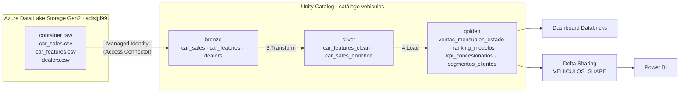

**Plano de control (CI/CD):**

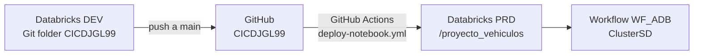

- La conexión a la capa raw se realiza **únicamente con Managed Identity** (Storage Credential `credential` sobre un Access Connector). No se usa DBFS ni Volúmenes como capa raw.
- Todas las tablas son **Delta externas**, cada capa en su propio container del Data Lake.
- Solo el clúster de **producción** (`ClusterSD`) queda encendido: allí se ejecuta el workflow.

---

## 3. Servicios de Azure utilizados

| Servicio | Uso en el proyecto |
|---|---|
| **Azure Data Lake Storage Gen2** (`adlsjgl99`) | Containers `raw`, `bronze`, `silver`, `golden` y `metastore` |
| **Access Connector for Azure Databricks** | Managed Identity usada por el Storage Credential `credential` |
| **Azure Databricks – Desarrollo** | Desarrollo de notebooks en el Git folder vinculado a GitHub |
| **Azure Databricks – Producción** | Despliegue de notebooks y ejecución del workflow `WF_ADB` |
| **Unity Catalog** | Catálogo `vehiculos`, external locations, permisos y Delta Sharing |
| **GitHub Actions** | Pipeline de CI/CD de desarrollo a producción |
| **Power BI** | Consumo de las tablas golden mediante Delta Sharing |

**Recursos aprovisionados en Azure:**

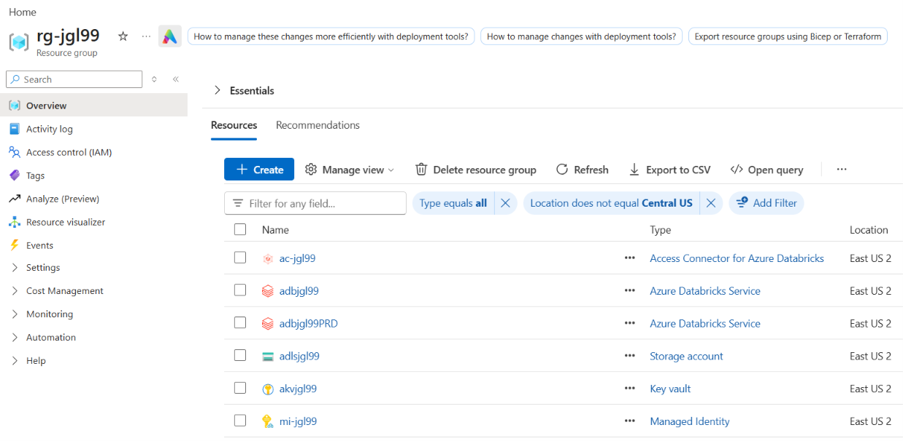

**Containers del Data Lake adlsjgl99:**

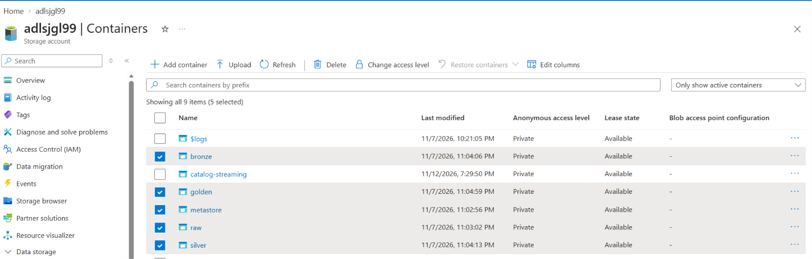

---

## 4. Datasets

| Archivo (container `raw`) | Filas | Origen | Contenido |
|---|---|---|---|
| `car_sales.csv` | 23.906 | Kaggle – *Car Sales Report* | Ventas de vehículos (ene-2022 a dic-2023): cliente, género, ingreso anual, concesionario, marca, modelo, motor, transmisión, color, carrocería, precio, sucursal y región |
| `car_features.csv` | 11.914 | Kaggle – *Car Features and MSRP* | Ficha técnica por marca/modelo/año: combustible, potencia, cilindros, transmisión, tracción, tamaño, consumo (MPG), popularidad y precio de lista (MSRP) |
| `dealers.csv` | 7 | Elaboración propia | Catálogo de sucursales. Se construyó a partir del campo `Dealer_No` de las ventas, que corresponde a códigos postales ZIP+4 de EE.UU. (ej. `06457-3834` = Middletown, CT). Incluye ciudad, estado y coordenadas |

Los tres archivos están versionados en la carpeta [`datasets/`](datasets/).

**Archivos fuente en el container raw:**

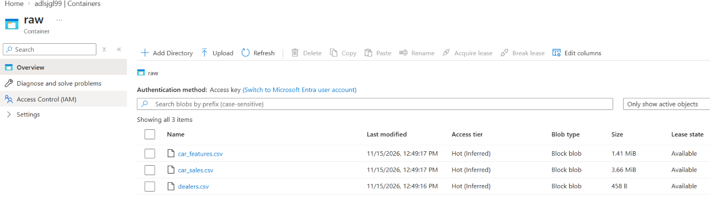

---

## 5. Estructura del repositorio

```
CICDJGL99/
├── .github/workflows/
│   └── deploy-notebook.yml        # CI/CD: despliegue DEV -> PRD y ejecución del workflow
├── PrepAmb/
│   └── 1.- Preparacion_Ambiente   # External locations, catálogo, esquemas y tablas (SQL)
├── proceso/                        # Notebooks que se despliegan y ejecutan en producción
│   ├── 1.Preparacion_Ambiente
│   ├── 2.Ingest_car_sales
│   ├── 2.Ingest_car_features
│   ├── 2.Ingest_dealers
│   ├── 3.Transform
│   ├── 4.Load
│   └── 5.Grants_Medallion
├── seguridad/
│   └── 4. Grants-Medallion         # Grants, usuarios, grupos, auditoría y revocación
├── delta-sharing/
│   └── 5. DeltaSharing             # Share y recipient para consumo externo
├── reversion/
│   └── 1. Drop-Medallion           # Eliminación de tablas lógicas y rutas físicas
├── datasets/                       # Insumos del ETL (CSV)
├── dashboard/                      # Dashboard exportado
├── evidencias/                     # Capturas de ejecución
├── certificaciones/                # Certificaciones obtenidas
└── README.md
```

---

## 6. Preparación de ambiente

Notebook: [`proceso/1.Preparacion_Ambiente`](proceso/1.Preparacion_Ambiente.ipynb) (idéntico a [`PrepAmb/1.- Preparacion_Ambiente`](PrepAmb/1.-%20Preparacion_Ambiente.ipynb)).

1. **External locations** `exlt-metastore`, `exlt-raw`, `exlt-bronze`, `exlt-silver` y `exlt-golden` con el Storage Credential `credential`.
2. **Catálogo** `vehiculos` con managed location en el container `metastore`. Se recrea en cada ejecución y se limpian las rutas físicas para que el proceso sea re-ejecutable.
3. **Esquemas** `raw`, `bronze`, `silver` y `golden`.
4. **Tablas Delta externas** de las tres capas (ver [Modelo de datos](#8-modelo-de-datos)).

Parámetro: `storageName` (por defecto `adlsjgl99`).

---

## 7. Proceso ETL

```
1.Preparacion_Ambiente ─┬─> 2.Ingest_car_sales ────┐
                        ├─> 2.Ingest_car_features ─┼─> 3.Transform ─> 4.Load
                        └─> 2.Ingest_dealers ──────┘
```

El notebook `5.Grants_Medallion` se despliega en producción junto con el resto, pero no forma parte del workflow `WF_ADB`: se ejecuta de forma independiente (ver [Seguridad](#10-seguridad)).

### 7.1 Extract – raw ➜ bronze

| Notebook | Destino | Técnicas |
|---|---|---|
| [`2.Ingest_car_sales`](proceso/2.Ingest_car_sales.ipynb) | `bronze.car_sales` | Schema explícito (`StructType`) que limpia nombres como `Price ($)` y `Dealer_No `; `select` + `alias`; conversión de fecha `M/d/yyyy` con `to_date`; tabla particionada por `sale_year` |
| [`2.Ingest_car_features`](proceso/2.Ingest_car_features.ipynb) | `bronze.car_features` | Schema explícito; `nullValue = "N/A"`; renombrado con `withColumnRenamed` |
| [`2.Ingest_dealers`](proceso/2.Ingest_dealers.ipynb) | `bronze.dealers` | Comparación `inferSchema` vs schema explícito (el ZIP `06457` pierde el cero con `inferSchema`); `trim`, `lpad`, `initcap`, `upper` |

En las tres ingestas: columnas de auditoría `source_file` (`_metadata.file_name`) e `ingestion_date`, validaciones previas a la carga y escritura con `insertInto` respetando el orden de columnas de la tabla.

Parámetros: `container`, `catalogo`, `esquema`, `storageName`.

### 7.2 Transform – bronze ➜ silver

Notebook: [`3.Transform`](proceso/3.Transform.ipynb)

**`silver.car_features_clean`**
- Eliminación de duplicados y nulos; normalización de marca/modelo.
- **Función de ventana** (`dense_rank` por año descendente) para quedarse con el año más reciente de cada modelo.
- Agregación a una fila por marca/modelo: `mode` para atributos de texto, promedio para numéricos, `is_luxury` a partir de `market_category`.

**`silver.car_sales_enriched`**
- Corrección de texto mal codificado con `regexp_replace` (`Double Overhead Camshaft` ➜ `Double Overhead Camshaft`).
- Nulos en nombre de cliente ➜ `Desconocido`; duplicados por `car_id`; precios no válidos.
- Columnas derivadas: `sale_month`, `sale_quarter`.
- **UDF** `segmento_ingreso` (Bajo / Medio / Alto / Premium) y `price_segment` con `when / otherwise`.
- Normalización de marca/modelo para cruzar con la ficha técnica: **reglas regex** (Lexus `LS400` ➜ `LS 400`, BMW `328i` ➜ `3 SERIES`) y **tabla de equivalencias** creada con `createDataFrame`.
- **Broadcast join** con `dealers` y left join con `car_features_clean`.
- Indicadores: `region_consistent`, `has_features`, `price_vs_msrp_pct`.

Parámetros: `catalogo`, `esquema_source`, `esquema_sink`.

### 7.3 Load – silver ➜ golden

Notebook: [`4.Load`](proceso/4.Load.ipynb)

| Tabla | Técnica destacada |
|---|---|
| `ventas_mensuales_estado` | Ventana con `lag` para la variación mes a mes (MoM) |
| `ranking_modelos` | Ventana con `dense_rank` por año |
| `kpi_concesionarios` | `row_number` para el modelo top + participación % sobre el total |
| `segmentos_clientes` | Agregación por ingreso, género y carrocería |

Al final se compactan las tablas golden con `DeltaTable.optimize().executeCompaction()`.

---

## 8. Modelo de datos

| Capa | Tabla | Descripción | Partición |
|---|---|---|---|
| bronze | `car_sales` | Ventas tipadas tal como llegan de la fuente | `sale_year` |
| bronze | `car_features` | Ficha técnica tipada | – |
| bronze | `dealers` | Catálogo de sucursales | – |
| silver | `car_features_clean` | Una fila por marca/modelo (año más reciente) | – |
| silver | `car_sales_enriched` | Ventas limpias + sucursal + ficha técnica + segmentos | `sale_year` |
| golden | `ventas_mensuales_estado` | Unidades, monto, ticket y variación MoM por estado | – |
| golden | `ranking_modelos` | Ranking anual de modelos por monto | – |
| golden | `kpi_concesionarios` | Desempeño y modelo top por concesionario | – |
| golden | `segmentos_clientes` | Compras por segmento de cliente | – |

**Catálogo `vehiculos` en Unity Catalog (producción):**

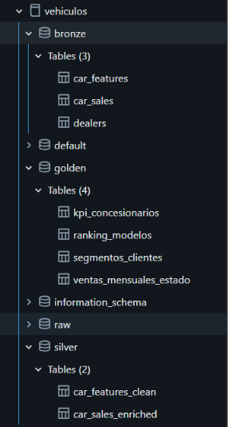

---

## 9. Calidad de datos

Hallazgos encontrados en las fuentes y cómo se resolvieron:

| Hallazgo | Tratamiento | Resultado |
|---|---|---|
| Nombres de modelo distintos entre ventas y ficha técnica (`Mercedes-B` vs `Mercedes-Benz`, `LS400` vs `LS 400`) | Reglas regex + tabla de equivalencias | Ventas con ficha técnica: **74 % ➜ 91,6 %**. El resto son marcas que no existen en la ficha técnica (Mercury, Saturn, Jeep, Jaguar) |
| El modelo Saab *9-3* aparece como `3-Sep` (Excel lo convirtió en fecha) | Tabla de equivalencias | Corregido a `9-3` / `9-5` |
| Caracteres mal codificados en `engine` | `regexp_replace` | 2 valores limpios: *Double Overhead Camshaft* / *Overhead Camshaft* |
| 715 filas duplicadas en la ficha técnica | `dropDuplicates` | 11.914 ➜ 11.199 filas ➜ 928 modelos únicos |
| Región de la venta distinta a la ciudad de la sucursal | Indicador `region_consistent` | 79,5 % de ventas consistentes |
| Código postal con cero inicial | Schema explícito + `lpad` | `06457` se conserva como texto |

---

## 10. Seguridad

Notebooks: [`proceso/5.Grants_Medallion`](proceso/5.Grants_Medallion.ipynb) (se despliega en producción y se ejecuta de forma independiente al workflow) y [`seguridad/4. Grants-Medallion`](seguridad/4.%20Grants-Medallion.ipynb) (versión ampliada con auditoría y revocación).

| Grupo | Usuarios | Permisos |
|---|---|---|
| `data_engineers` | `data_engineer1@outlook.com`, `data_engineer2@outlook.com` | `USE CATALOG`; en bronze, silver y golden: `USE SCHEMA`, `SELECT`, `MODIFY`, `CREATE TABLE`; external locations: `READ FILES` en `exlt-raw` y `READ FILES`, `WRITE FILES`, `CREATE EXTERNAL TABLE` en `exlt-bronze`, `exlt-silver` y `exlt-golden` |
| `analistas` | `analista1@outlook.com`, `analista2@outlook.com` | `USE CATALOG`; `USE SCHEMA` y `SELECT` en silver y golden |
| `consumidores_bi` | `consumidor_bi1@outlook.com`, `consumidor_bi2@outlook.com` | `USE CATALOG`; `USE SCHEMA` en golden; `SELECT` solo sobre las 4 tablas golden |
| Usuario individual | `analista1@outlook.com` | `SELECT` sobre `bronze.dealers` (excepción puntual) |

Los usuarios y grupos se administran desde la **Account Console** y están asignados al workspace de producción.

**Grupos en la Account Console:**

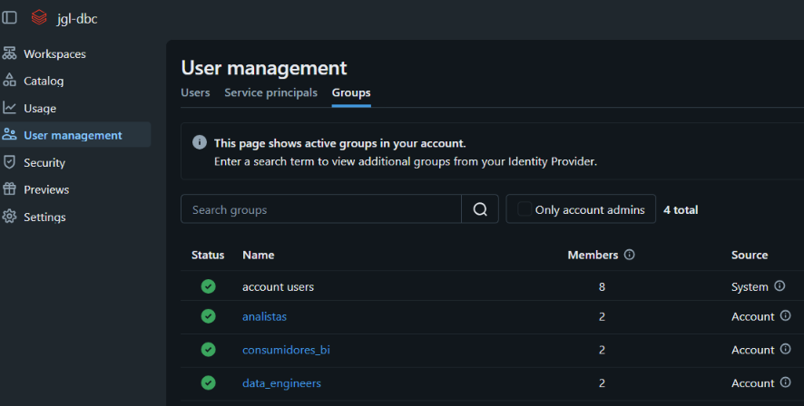

**Permisos sobre el esquema golden (SHOW GRANTS):**

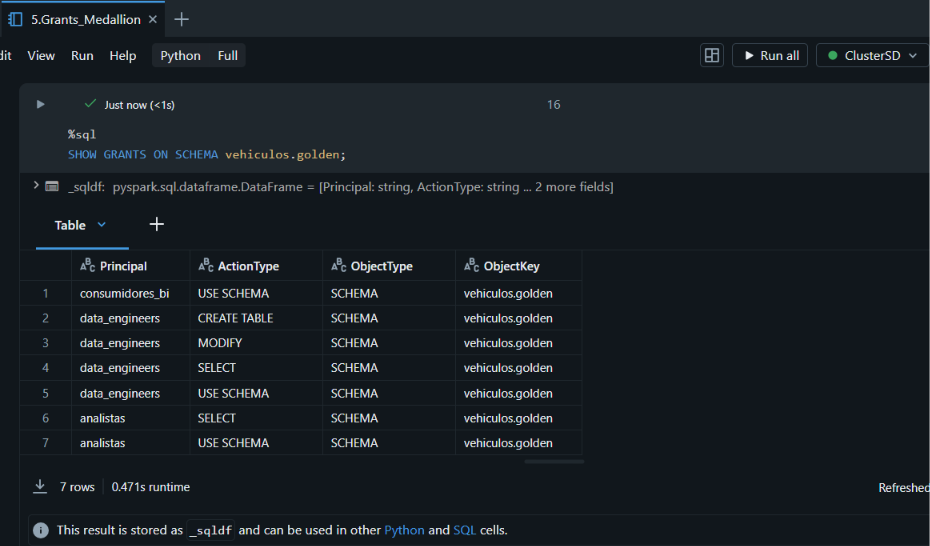

---

## 11. Delta Sharing

Notebook: [`delta-sharing/5. DeltaSharing`](delta-sharing/5.%20DeltaSharing.ipynb)

| Objeto | Detalle |
|---|---|
| Share | `VEHICULOS_SHARE` |
| Tablas | 4 tablas golden + `silver.car_features_clean`, todas `WITH HISTORY` |
| Recipient | `PartnerConcesionarios` (open sharing con enlace de activación) |

No se comparte `silver.car_sales_enriched` porque contiene datos personales de clientes (nombre, teléfono e ingreso). El consumo del share se probó desde **Power BI**.

**Tablas del share VEHICULOS_SHARE:**

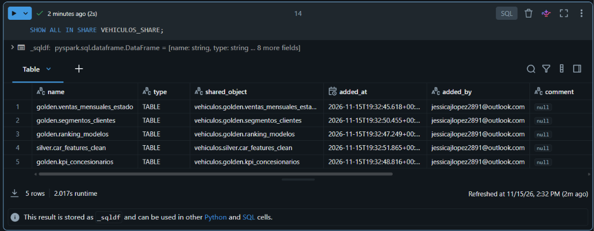

**Power BI consumiendo las tablas del share:**

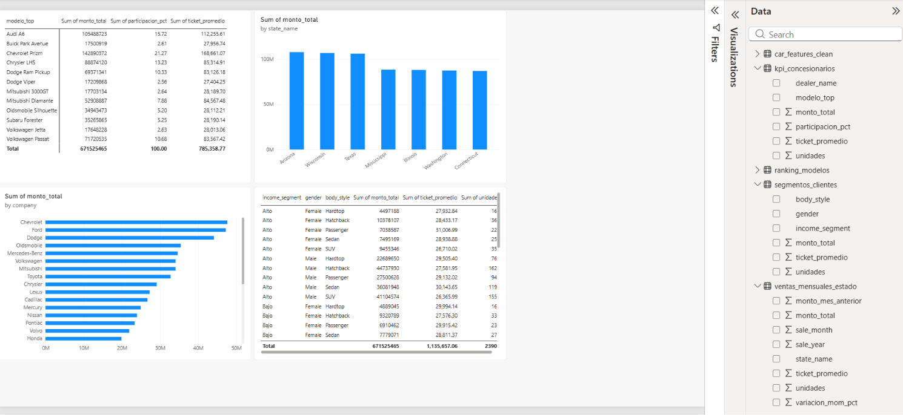

---

## 12. Reversión

Notebook: [`reversion/1. Drop-Medallion`](reversion/1.%20Drop-Medallion.ipynb)

Elimina, capa por capa, las **tablas lógicas** (`DROP TABLE`) y sus **rutas físicas** en el Data Lake (`dbutils.fs.rm`), ya que al ser tablas externas `DROP TABLE` solo borra la metadata. Incluye, comentada, la reversión completa de esquemas, catálogo y external locations. El container `raw` no se modifica.

---

## 13. CI/CD con GitHub Actions

Workflow: [`.github/workflows/deploy-notebook.yml`](.github/workflows/deploy-notebook.yml) — se dispara con cada **push a `main`**.

| # | Paso | Descripción |
|---|---|---|
| 1 | Export | Exporta los 7 notebooks de `proceso` desde el workspace de **desarrollo** |
| 2 | Deploy | Los importa en el workspace de **producción** en `/proyecto_vehiculos` |
| 3 | Limpieza | Elimina el workflow `WF_ADB` si ya existe |
| 4 | Cluster | Obtiene el ID del clúster existente `ClusterSD` |
| 5 | Create | Crea el workflow `WF_ADB` con 6 tareas (preparación, 3 ingestas, transform y load) y sus dependencias |
| 6 | Validate | Verifica la configuración del workflow creado |
| 7 | Run | Ejecuta el workflow |
| 8 | Monitor | Monitorea la ejecución hasta que termina (máx. 20 min) |

**Secrets requeridos** en el repositorio:

| Secret | Descripción |
|---|---|
| `DATABRICKS_ORIGIN_HOST` / `DATABRICKS_ORIGIN_TOKEN` | URL y token del workspace de desarrollo |
| `DATABRICKS_DEST_HOST` / `DATABRICKS_DEST_TOKEN` | URL y token del workspace de producción |

**Historial de ejecuciones del pipeline en GitHub Actions:**

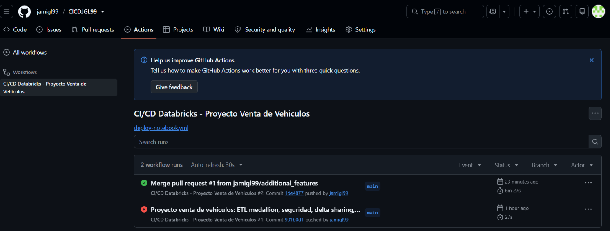

**Detalle de la ejecución correcta (todos los pasos en verde):**

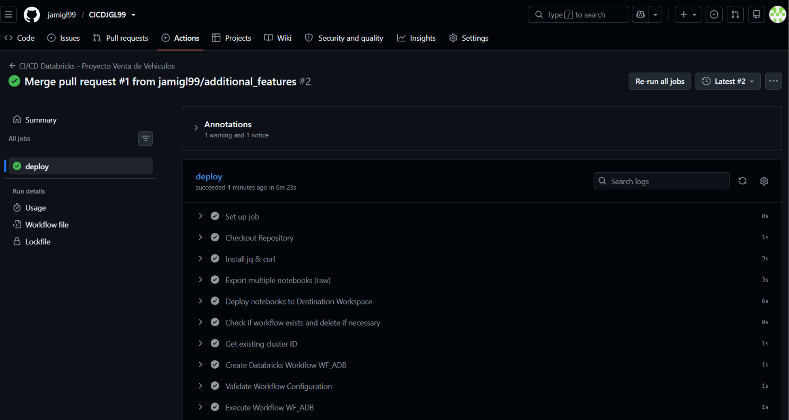

**Notebooks desplegados en el workspace de producción (`/proyecto_vehiculos`):**

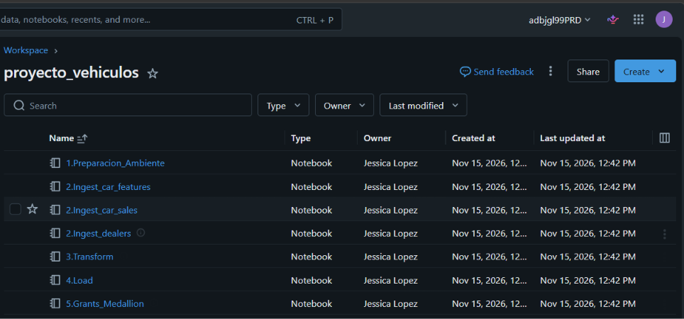

**Workflow `WF_ADB` en producción:**

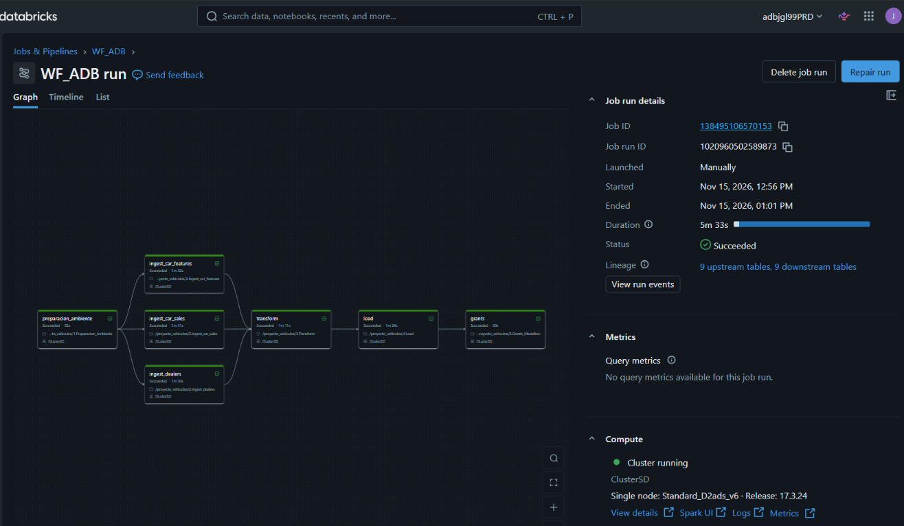

---

## 14. Dashboard

Dashboard construido en Databricks sobre las tablas golden. El archivo exportado se encuentra en [`dashboard/`](dashboard/).

**Dashboard de venta de vehículos en Databricks:**

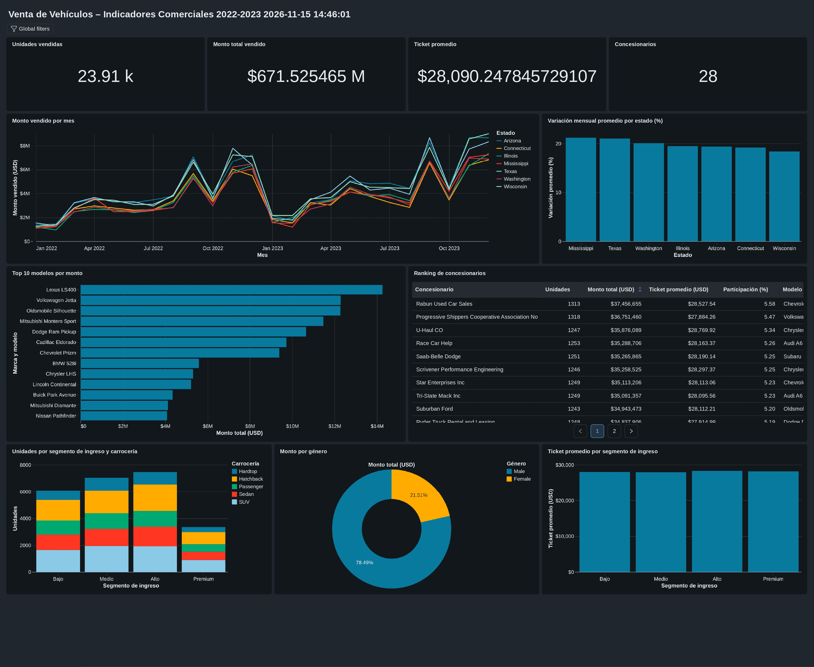

---

## 15. Evidencias

Todas las capturas de ejecución se encuentran en la carpeta [`evidencias/`](evidencias/):

- Servicios aprovisionados en Azure y containers del Data Lake.
- Archivos fuente en el container `raw`.
- Catálogo `vehiculos` en Unity Catalog.
- Ejecución correcta del pipeline en GitHub Actions.
- Ejecución correcta del workflow `WF_ADB` en producción.
- Grants, grupos y Delta Sharing.

---

## 16. Certificaciones

| Certificación | Verificación |
|---|---|
| Databricks Fundamentals | [Ver credencial](https://credentials.databricks.com/27daf880-99d2-4cad-b8ce-72e97c4b7681#acc.dslaiqgz) |


---

**Autor:** Jamil Gutierrez Loaiza

